<div align="center">


# Sistema Otiniano

### Control interno para un negocio de reciclaje: compras, limpieza, stock, ventas y caja — cada kilo y cada sol, bajo control


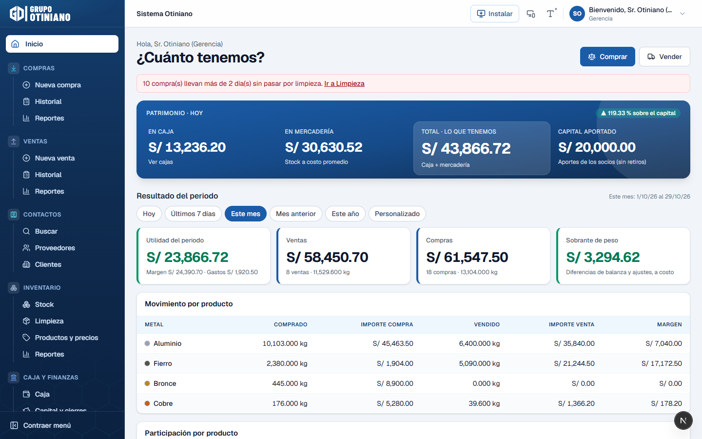

</div>

---

## 📌 ¿De qué trata?

**Grupo Otiniano** compra chatarra (cobre, bronce, aluminio, fierro…) a personas y a otros almacenes,
la **limpia**, la acumula y la vende a fundiciones y recicladoras. Hasta ahora todo se anotaba en
cuadernos y nadie sabía con certeza cuánto material había.

Este sistema responde, en cualquier momento y desde la oficina, las preguntas del dueño:

| ¿Cuánto hay en **caja**? | ¿Cuánto hay en **mercadería**? | ¿Cuánto **ganamos**? |
|:---:|:---:|:---:|
| Saldo por caja chica, banco y Yape/Plin | Kilos × costo promedio, por producto y por nivel | Utilidad del periodo y sobre el capital aportado |

> *«Si se compraron 1 000 kg de chatarra con aluminio mezclado, al limpiar debe subir el stock de
> chatarra y bajar lo mismo en aluminio. Si el stock no cuadra, llamo al encargado: según el sistema
> deberías tener tanto.»*

Es una **aplicación web instalable (PWA)** sin página pública: se entra con correo y contraseña y el
sistema lleva a cada persona a **su panel según su rol**. El almacenero la usa en el **celular** en el
local; Gerencia la revisa en la **computadora**. Está hecha **multiempresa** desde el inicio.

---

## 🔄 El flujo del material

```
  Proveedor ──► COMPRA ──► LIMPIEZA ──► STOCK ──► VENTA ──► Comprador
               (pesa y      (vuelve a    (por       (no se vende
                paga,        pesar: merma producto,  más de lo
                ticket       en kg y S/,  costo      que hay)
                80 mm)       material de  promedio)
                             otra clase
                             pasa a su
                             producto)
                    │                                  │
                    └────────────►  CAJA  ◄────────────┘
                         (cada pago y cobro sale o entra de una caja;
                          apertura y cierre del día con ticket de cuadre)
```

---

## 👥 Roles

Cada rol ve su propio menú y su propia pantalla de inicio. La base de datos hace cumplir los permisos
(los botones ocultos en pantalla son solo comodidad).

| Rol | Quién | Qué hace |
|---|---|---|
| **Gerencia** | El dueño | Ve todo: patrimonio, stock, caja, capital, utilidad y reportes. Anula, configura y crea usuarios. |
| **Administración** | El encargado | Productos y precios, proveedores y clientes, reportes. Corrige tickets emitidos. |
| **Almacén** | Personal del local | Registra compras y ventas, pesa, hace la limpieza, abre y cierra la caja del día. |

---

## ✨ Módulos

### 🔐 Acceso

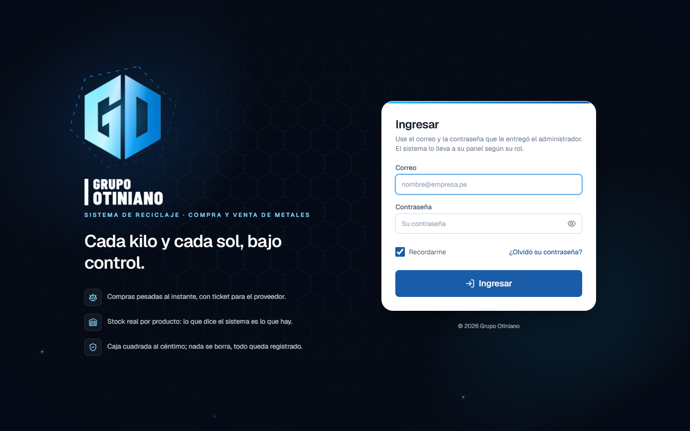

Correo y contraseña; el sistema decide a qué panel entrar según el rol. Recuperación de contraseña por
correo. Los usuarios los crea Gerencia desde *Configuración* (no hay registro abierto).

### 🏠 Inicio de Gerencia — «¿Cuánto tenemos?»

La pantalla de arriba. **Caja + mercadería** frente al **capital aportado**, resultado del periodo
(hoy, 7 días, mes, año o rango libre), movimiento y participación por producto, y avisos (por ejemplo,
compras que llevan días sin pasar por limpieza). Todo se calcula en la base de datos.

### ⬇️ Compras

| Nueva compra | Historial |
|:---:|:---:|
| 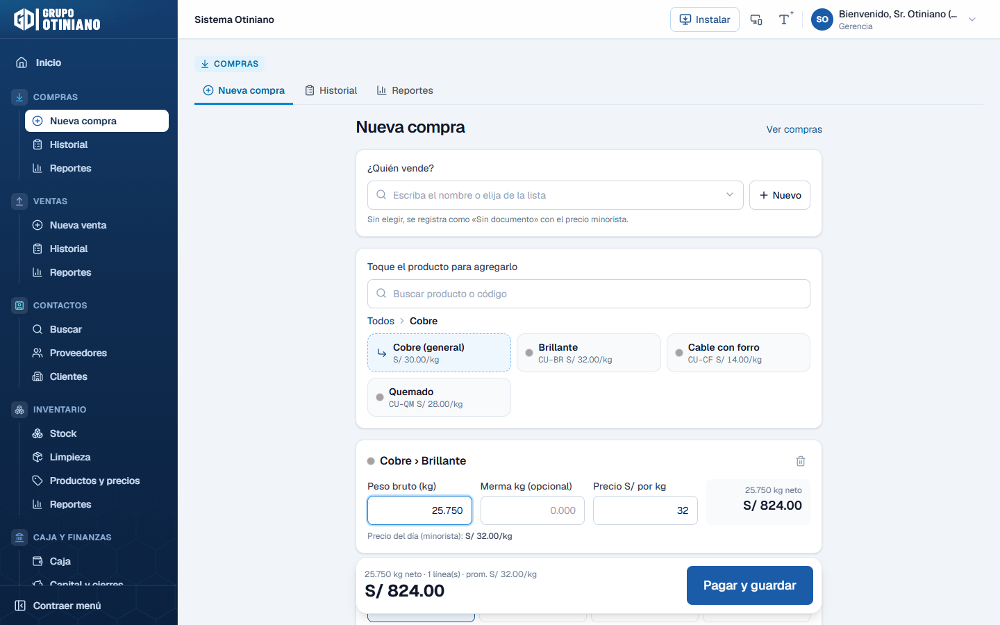 | 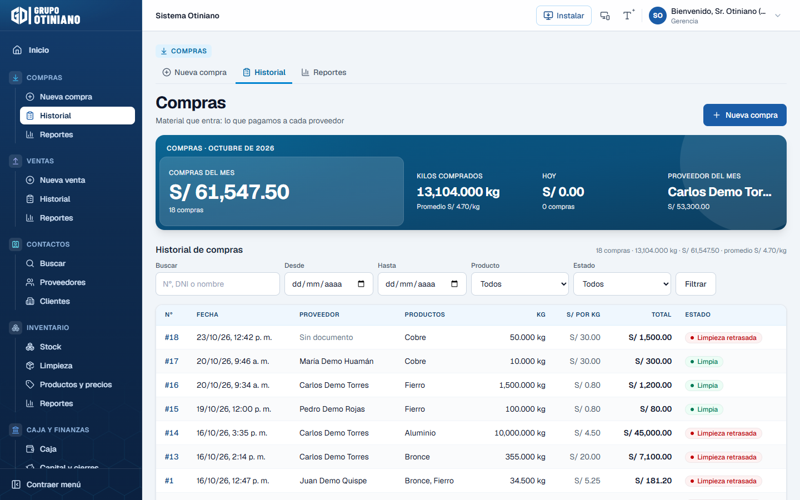 |

- **Proveedor** con buscador por nombre; uno nuevo se da de alta con DNI, RUC o carné de extranjería y se
  **autocompleta** (RENIEC/SUNAT vía Decolecta; cada documento se consulta una sola vez). Sin elegir,
  queda como «Sin documento».
- Productos en **mosaicos táctiles** que se abren por niveles (Cobre → Brillante…); una compra puede
  llevar varios.
- **Peso bruto − merma = peso neto**, precio por kg **sugerido según el proveedor** (mayorista o
  minorista) y total en vivo.
- Medio de pago (efectivo, Yape, Plin, transferencia — editables) y de qué caja sale. Foto y nota opcionales.
- **Ticket térmico de 80 mm** (impresión directa) y PDF para compartir.
- Una vez emitido, el almacén **no puede editar** peso ni precio: la corrección la hace Gerencia o
  Administración, ajusta stock y caja, y queda registrado quién la hizo.

### 🧹 Limpieza

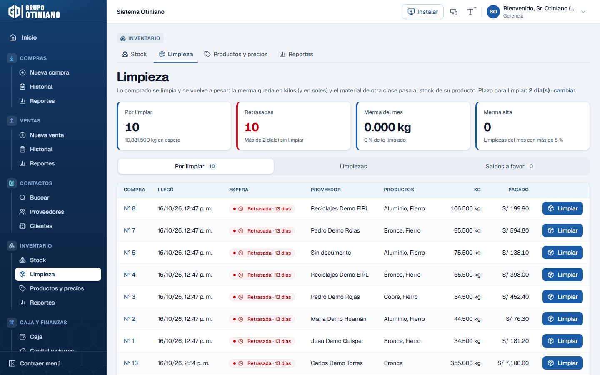

Lo comprado pasa por limpieza y se **vuelve a pesar**. La merma se guarda **en kilos y en soles**, y el
material de otra clase que salió (el fierro dentro del aluminio) **pasa al stock de su producto**: baja
uno y sube el otro en la misma cantidad. Se marcan las compras retrasadas (plazo configurable) y las
limpiezas con merma alta.

### 📦 Inventario y productos

| Stock | Productos y precios |
|:---:|:---:|
| 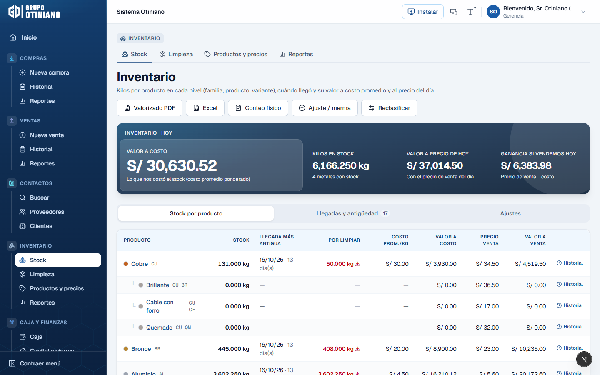 | 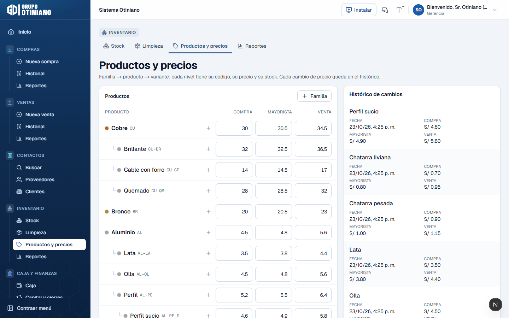 |

- **Stock por cada nivel** de la jerarquía, a **costo promedio ponderado**, valor al precio del día,
  ganancia si se vendiera hoy y **fecha de la llegada más antigua**.
- **Kardex** por producto (cada entrada y salida), conteo físico, ajustes y reclasificación.
- **Jerarquía libre de productos**: familia → producto → variante (y variantes de variantes), cada nivel
  con su código y precios de **compra, mayorista y venta**. Cada cambio de precio queda en el histórico.

### ⬆️ Ventas

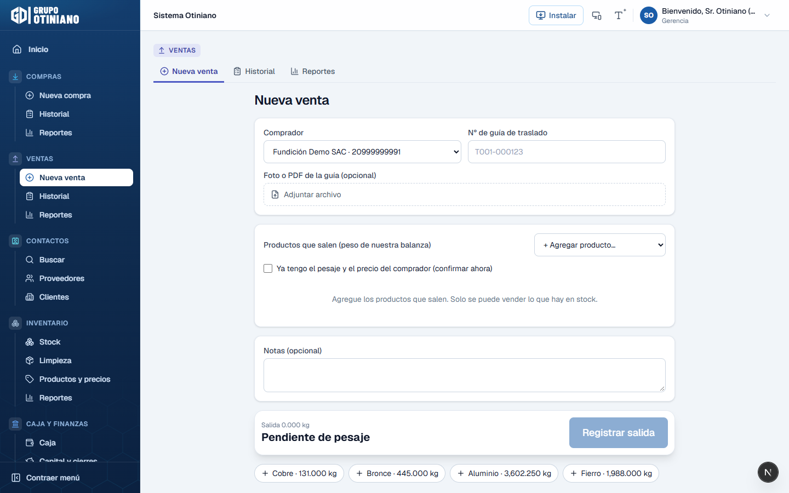

Comprador, productos que salen con el **peso de nuestra balanza** y el **stock disponible a la vista**
(no se puede vender más de lo que hay), número de guía de traslado y foto o PDF de la guía. Luego se
confirma el pesaje y precio del comprador y la diferencia de peso se registra sola. Nota de venta en PDF
y ticket de 80 mm.

### 💰 Caja y finanzas

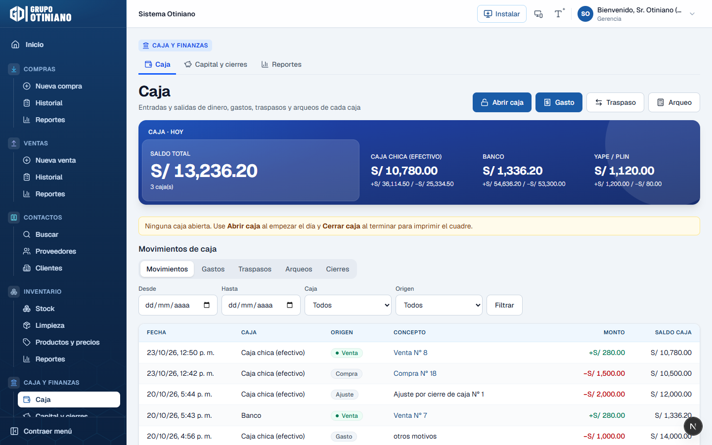

- Saldo por caja (efectivo, banco, Yape/Plin) y cada movimiento con su origen.
- **Apertura y cierre del día** con ticket de cuadre en 80 mm; gastos por categoría, traspasos entre
  cajas y **arqueo** (lo contado vs. lo que dice el sistema).
- **Capital de socios**, aportes y retiros, y **cierre de mes** (guarda el resultado y bloquea el periodo).

### 📊 Reportes

| En pantalla | En PDF |
|:---:|:---:|
| 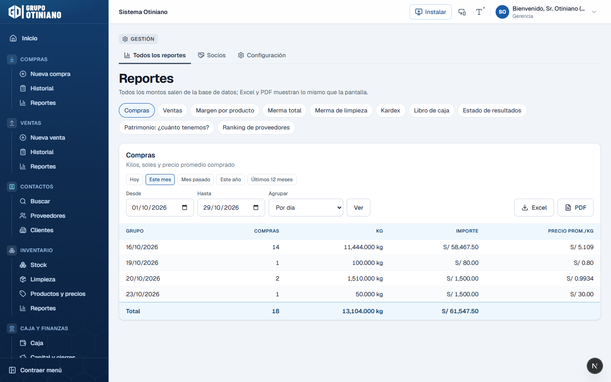 | 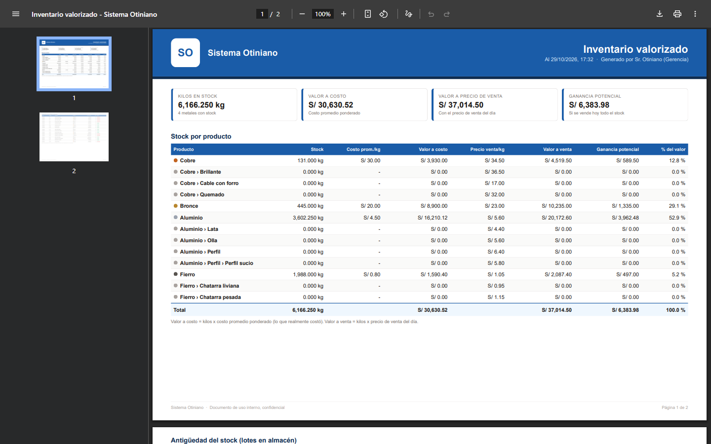 |

Compras, ventas, margen por producto, merma total y de limpieza, kardex, libro de caja, estado de
resultados, patrimonio y ranking de proveedores. Todos con filtros de periodo y exportables a
**Excel y PDF** con los mismos números que la pantalla.

### 📱 En el celular

| Inicio de Almacén | Nueva compra | Historial |
|:---:|:---:|:---:|
| 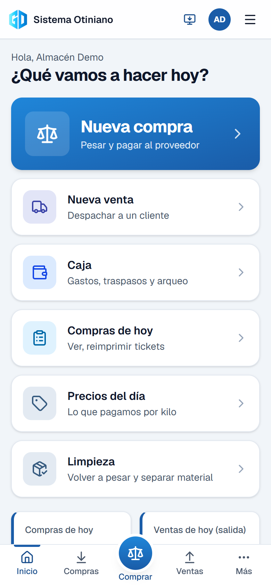 | 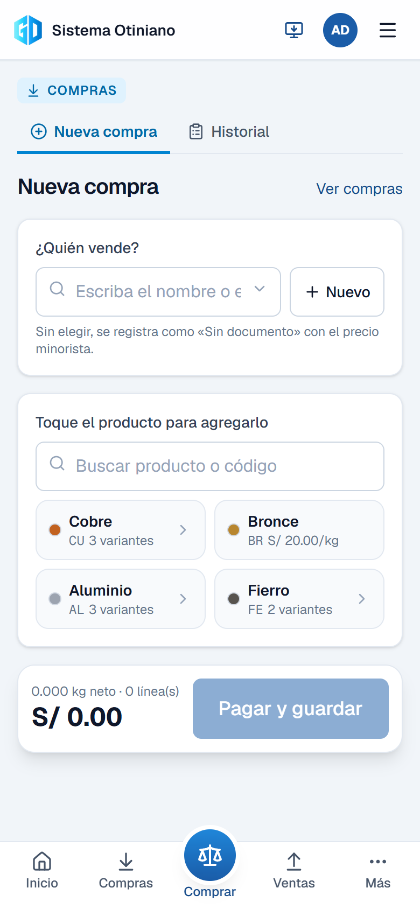 | 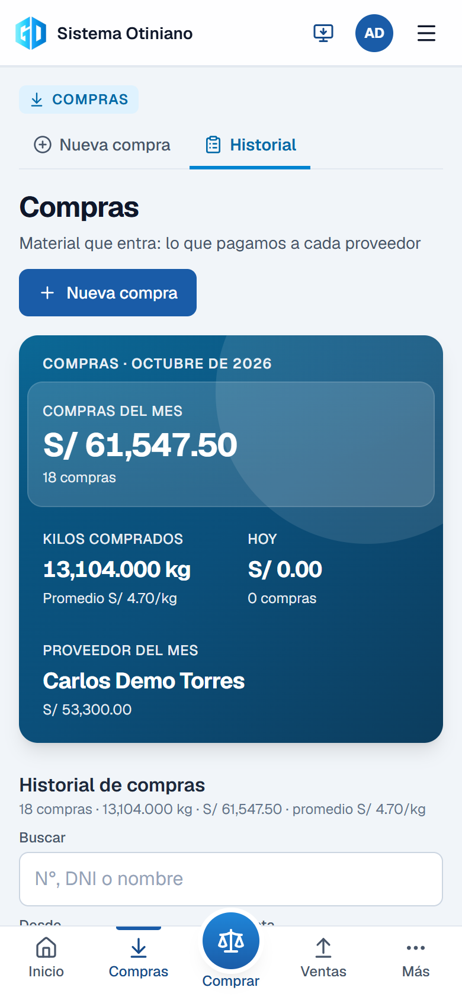 |

Diseño responsive real: las tablas se vuelven tarjetas, barra inferior con el botón **Comprar** al
centro y menú por módulos. Se instala como app desde el navegador.

### 🌙 Modo oscuro y letra grande

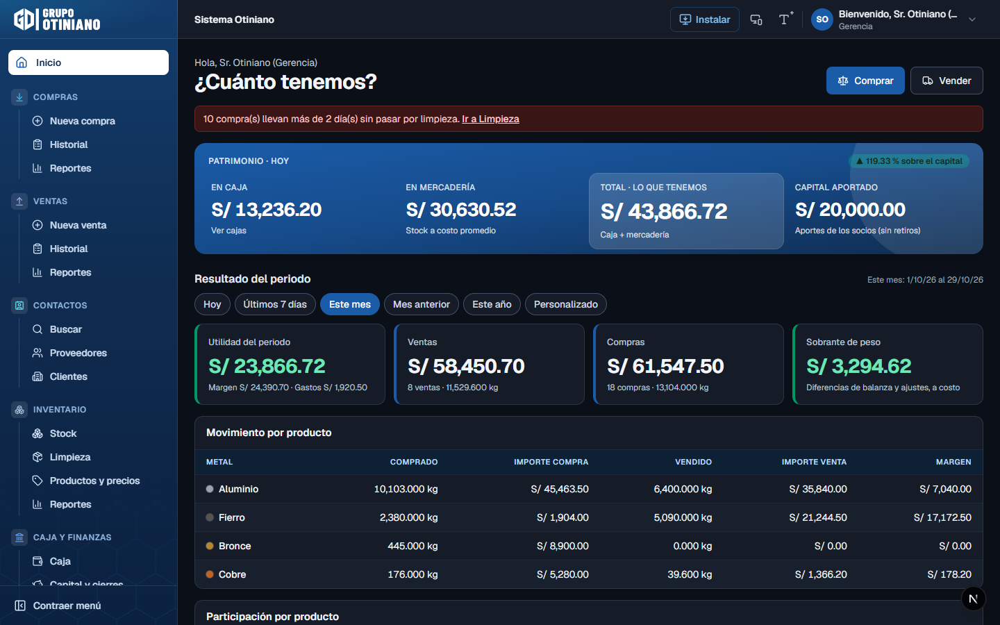

> Todas las capturas usan la **empresa de datos de prueba**, no datos reales.

---

## 🏗️ Cómo está construido

```
 Celular / PC (navegador, PWA)
            │
            ▼
 Next.js 15 (App Router) ── Server Components leen vistas
            │               Server Actions llaman funciones RPC
            ▼
 Supabase (nube) ── Postgres: tablas + funciones + vistas
                    Auth (usuarios) · Storage (fotos, guías) · RLS (seguridad por empresa)
```

**La regla de oro:** *el dinero y el inventario se calculan en la base de datos, nunca en la pantalla.*

- Cada operación (comprar, limpiar, vender, corregir, anular, gasto, traspaso, cierre…) es **una función
  de Postgres en una sola transacción**: se guarda todo (compra + caja + stock + kardex) o nada.
- **RLS:** cada empresa solo ve sus datos, y lo garantiza la base de datos. Las tablas de operación no se
  escriben directo; solo vía funciones que validan el rol.
- **Nada se borra:** se **anula con motivo** y queda registrado quién lo hizo.
- **Costo promedio ponderado** valorizado al céntimo en cada salida, para que
  *caja + stock − capital = utilidades* cuadre exacto.
- Montos en **enteros** (gramos y céntimos) para no arrastrar errores de redondeo.
- Compras **a prueba de reintentos**: si el celular pierde señal y reenvía, no se duplica.

<details>
<summary><b>Estructura de carpetas</b></summary>

```
src/
  app/(app)/          pantallas con sesión: comprar, compras, limpieza, vender, ventas, contactos,
                      proveedores, compradores, socios, inventario, precios, caja, capital,
                      reportes, configuracion, cuenta
  app/imprimir/       tickets HTML de 80 mm (compra, venta, cierre de caja)
  app/login           acceso · app/restablecer: nueva contraseña
  app/api/            exportar reportes, consulta DNI/RUC
  components/ui       botones, campos, tablas (tarjetas en celular), modales, pestañas
  components/shell    menú lateral por módulos, pestañas, barra inferior del celular
  components/ticket   tickets térmicos de 80 mm
  lib/                sesión y empresa, permisos, formato es-PE, PDF y Excel
supabase/
  migrations/         esquema, seguridad (RLS), funciones, vistas y reportes
  scripts/            alta de empresa y datos de prueba
tests/                pruebas automáticas (Postgres embebido, sin internet)
docs/                 capturas y documentación
```
</details>

---

## 🚀 Puesta en marcha

**Requisitos:** Node 20+, pnpm 10 y una cuenta en [Supabase](https://supabase.com) (se usa en la nube,
no hace falta Docker).

```bash
pnpm install
cp .env.example .env.local       # completar URL y claves de Supabase
pnpm supabase:conectar           # pide el token de forma oculta y enlaza el proyecto (Windows)
pnpm db:push                     # sube tablas, funciones y vistas
pnpm dev                         # http://localhost:3000
```

<details>
<summary><b>Paso a paso detallado</b></summary>

1. **Crear el proyecto** en <https://supabase.com/dashboard> (región *South America – São Paulo*).
2. En **Project Settings → API** copiar `Project URL`, la `anon key` y la `service_role key` a `.env.local`.
3. En **Authentication → Sign In / Providers → Email**, desactivar *Allow new users to sign up*
   (los usuarios los crea Gerencia desde la app).
4. `pnpm supabase:conectar` y luego `pnpm db:push`.
   *Alternativa sin CLI:* en **SQL Editor**, ejecutar en orden los archivos de `supabase/migrations/`.
5. **Crear empresa y dueño:** *Authentication → Users → Add user* (marcar *Auto Confirm*) y luego
   ejecutar `supabase/scripts/01_crear_empresa.sql` con ese correo.
6. *(Opcional, solo en una empresa de prueba)* `supabase/scripts/02_datos_demo.sql` y
   `pnpm demo:preparar` (un usuario por rol y productos de ejemplo).
7. *(Opcional)* `CONSULTA_DOC_TOKEN` de [Decolecta](https://decolecta.com) para autocompletar DNI/RUC.

En `pnpm dev`, abriendo desde `localhost`, el login muestra un **ingreso directo por rol** con los usuarios
de prueba. No existe en producción ni desde otra IP de la red.

**Despliegue:** importar el repo en Vercel, cargar las mismas variables y, en Supabase →
*Authentication → URL Configuration*, agregar la URL de producción.
</details>

### Comandos

| Comando | Qué hace |
|---|---|
| `pnpm dev` | Servidor de desarrollo |
| `pnpm test` | Pruebas: casos de negocio, seguridad multiempresa, scripts, PDF y tickets |
| `pnpm typecheck` · `pnpm lint` · `pnpm build` | Verificaciones antes de entregar |
| `pnpm db:push` | Sube migraciones nuevas a Supabase |
| `pnpm db:types` | Regenera los tipos TypeScript desde la base |
| `pnpm db:validar` | Prueba las migraciones en un Postgres local embebido |
| `pnpm demo:preparar` | Usuarios por rol y productos de ejemplo en la empresa demo |

---

## 🧪 Pruebas

Las pruebas levantan un **Postgres embebido (PGlite)**, aplican todas las migraciones y verifican los
casos de negocio:

- ✅ Compra con descuento de peso → total exacto al céntimo
- ✅ Dos compras a distinto precio → costo promedio ponderado correcto
- ✅ Precio sugerido distinto para proveedor mayorista y minorista
- ✅ Limpieza: merma en kg y S/, y el material separado pasa al stock de otro producto
- ✅ Corrección de un ticket emitido → stock y caja se ajustan y queda el registro
- ✅ Vender más que el stock → la base de datos lo rechaza
- ✅ Anular una compra → caja y stock vuelven a como estaban
- ✅ Mes cerrado → no se puede registrar ni anular
- ✅ Una empresa no ve ni escribe datos de otra; Almacén no anula ni cambia precios
- ✅ Patrimonio = caja + stock + en tránsito, y cuadra con las utilidades

---

## 🗺️ Estado y próximos pasos

- [x] Compras, limpieza, inventario, ventas, caja, capital, reportes y multiempresa
- [x] Roles Gerencia / Administración / Almacén con inicio propio
- [x] Productos en jerarquía libre con precio mayorista y minorista
- [x] Corrección de tickets con registro, apertura y cierre de caja con ticket de 80 mm
- [x] Autocompletado de DNI/RUC, modo oscuro, letra grande, PWA
- [ ] Cargar la lista real de productos y precios del cliente
- [ ] Probar en el local con la balanza y la impresora térmica
- [ ] Siguiente etapa: guías de remisión, boletas y facturas con SUNAT

📄 Especificación: [`PROPUESTA_SISTEMA_CHATARRA.md`](PROPUESTA_SISTEMA_CHATARRA.md) ·
📝 Cambios de la reunión del 23/10: [`Sistema de Reciclaje Otiniano — Requerimientos.md`](Sistema%20de%20Reciclaje%20Otiniano%20—%20Requerimientos.md) ·
📘 Guía de roles y flujos: [`PDF`](Guia%20de%20roles%20y%20flujos%20-%20Sistema%20Otiniano.pdf)
